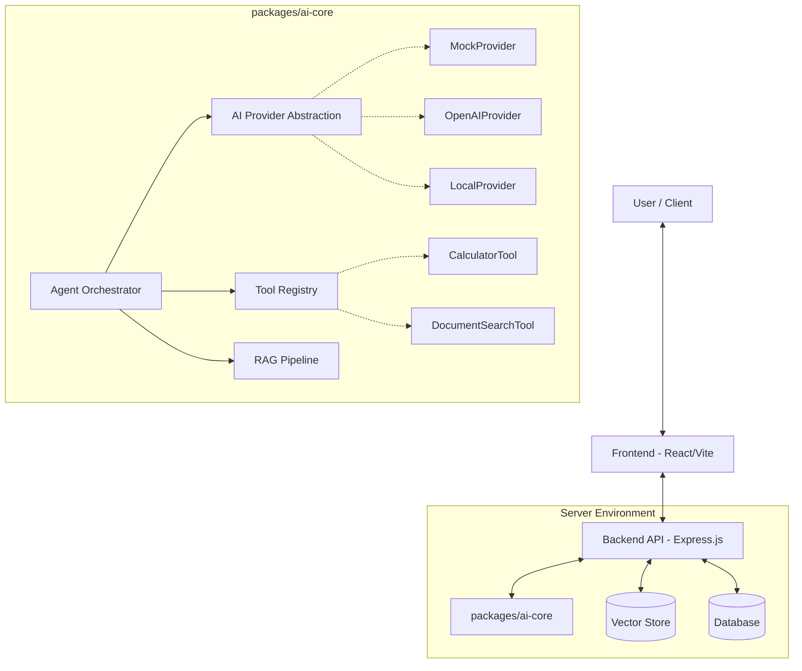

# OpenForge AI Architecture

OpenForge AI is designed as a modular, adaptable framework for rapid AI application development during hackathons.

## High-Level Architecture

## Core Modules

### 1. AI Core (`packages/ai-core`)
This is the heart of the application. It contains the interfaces and base implementations for Agents, Providers, Tools, and RAG. 
By keeping this in a separate package, the frontend and backend can share types, and the abstractions remain decoupled from any specific web framework.

### 2. Provider Abstraction
The `AIProvider` interface ensures the platform never hard-codes a dependency on a single vendor (like OpenAI). A `MockProvider` is included out of the box for `DEMO_MODE`, ensuring hackathon presentations work even without internet access or when API quotas run out.

### 3. Tool Registry
Tools are defined by implementing the `Tool` interface. They declare an `inputSchema` which the Agent uses to determine when and how to call the tool.

### 4. RAG Pipeline
The RAG pipeline consists of:
- **DocumentLoader**: Parses PDFs, TXTs.
- **TextChunker**: Splits text into manageable sizes with overlap.
- **EmbeddingProvider**: Converts text to vectors.
- **VectorStore**: Stores and searches vectors.

For `DEMO_MODE`, we use an `InMemoryVectorStore` and `MockEmbeddingProvider`.
